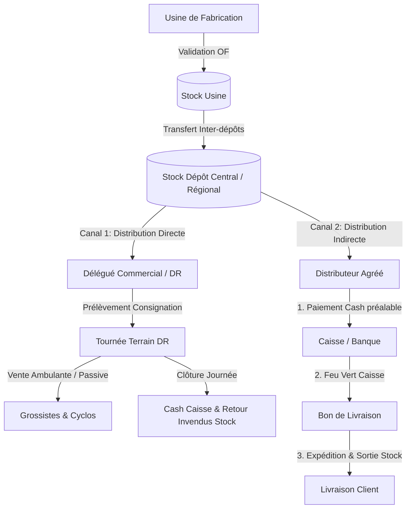

# Guide Complet des Workflows & Processus CODIS

Ce document détaille le fonctionnement global de l'application CODIS : le cycle de vie d'un produit, la passation de commande, les étapes de validation et les **impacts automatiques sur les stocks à chaque étape**.

---

## 🗺️ 1. Vue d'Ensemble de la Chaîne de Valeur



---

## 🏭 2. Phase 1 : Fabrication & Stock Usine (`/production`)

1. **Création d'un Ordre de Fabrication (OF)** :
   - Vous saisissez l'usine, le produit et la quantité à produire.
   - Un **N° de Lot** (avec sa date de péremption) et un numéro d'ordre (`OF-YYYYMMDD-XXXX`) sont générés.
   - **Statut** : `BROUILLON` *(Aucun impact stock pour le moment)*.

2. **Validation de l'Ordre de Fabrication** :
   - Lorsque la production physique est terminée, vous cliquez sur **Valider**.
   - **Impact Stock** : 
     - 🟢 **`+ Quantité Produite`** ajoutée automatiquement dans l'emplacement **Stock Usine**.
     - Statut passe à `VALIDEE`.

---

## 🚚 3. Phase 2 : Distribution Directe (Par les agents propres CODIS) (`/consignations`)

Ce canal est géré par la hiérarchie interne CODIS (**ASM ➔ Superviseur des Ventes ➔ DR ➔ Cyclos / Grossistes du secteur**).

```
Demande DR ➔ Validation Superviseur (L1) ➔ Validation ASM (L2) ➔ Sortie Stock ➔ Tournée ➔ Clôture Cash & Invendus
```

1. **Demande de Prélèvement** :
   - Le DR crée une demande pour sa tournée du jour (ex: *150 cartons d'Équateur Rouge*).
   - Statut : `SOUMISE`. *(Pas encore de sortie de stock)*.

2. **Double Validation** :
   - **Niveau 1** : Le **Superviseur des Ventes** approuve (`VALIDEE_SUPERVISEUR`).
   - **Niveau 2** : L'**ASM (Area Sales Manager)** valide définitivement (`VALIDEE_ASM`).
   - **Impact Stock** : 
     - 🔴 **`- Quantité Prélévée`** déduite du Stock Dépôt et confiée au DR.

3. **Clôture & Justification de Journée (Fin de Tournée)** :
   - En fin de journée, le DR enregistre le **Cash total encaissé à la Caisse** et déclare les **Invendus**.
   - **Impact Stock** :
     - 🟢 **`+ Quantité Invendue`** automatiquement réintégrée dans le Stock Dépôt.
     - Statut passe à `CLOTUREE`.

---

## 🤝 4. Phase 3 : Distribution Indirecte (Par les Distributeurs Agréés) (`/commandes` & `/livraisons`)

Ce canal concerne les partenaires grossistes/distributeurs indépendants auxquels CODIS confie un territoire.

```
Commande Client ➔ RÈGLEMENT CAISSE PRÉALABLE ➔ Bon de Livraison (BL) ➔ Expédition & Sortie Stock ➔ Confirmation Réception
```

1. **Prise de Commande** :
   - Saisie de la commande pour le Distributeur Agréé (`SOUMISE`).
   - *Règle Métier Stricte* : La livraison est **verrouillée** tant que le paiement n'est pas effectué.

2. **Passage en Caisse & Règlement** (`/paiements`) :
   - Le Distributeur Agréé verse le cash (ou virement / mobile money) à la Caisse.
   - La Caisse valide le paiement (`VALIDE`).

3. **Génération du Bon de Livraison (BL) & Expédition** (`/livraisons`) :
   - Le système vérifie que le paiement est OK ➔ le bouton **Expédier** se débloque.
   - **Impact Stock** :
     - 🔴 **`- Quantité Livrée`** sortie définitivement du Stock Dépôt lors de l'expédition (`EN_TRANSIT`).

4. **Confirmation de Réception** :
   - Le client reçoit sa marchandise, la livraison passe à `RECEPTION_CONFIRMEE` et la commande à `RECEPTIONNEE`.

---

## 📊 5. Tableau Synthétique des Événements & Impacts Stocks

| Étape / Action | Statut | Impact automatique sur le Stock |
| :--- | :--- | :--- |
| **Création Ordre Fabrication** | `BROUILLON` | ⚪ Aucun impact |
| **Validation Ordre Fabrication** | `VALIDEE` | 🟢 **`+ Stock Usine`** |
| **Validation Prélèvement DR (ASM)** | `VALIDEE_ASM` | 🔴 **`- Stock Dépôt`** (Stock confié au DR) |
| **Clôture Journée DR** | `CLOTUREE` | 🟢 **`+ Stock Dépôt`** (Réintégration des invendus) |
| **Commande Client Indirecte** | `SOUMISE` | ⚪ Aucun impact |
| **Règlement Caisse** | `VALIDE` | 🟡 Autorise la création et l'expédition du Bon de Livraison |
| **Expédition Bon de Livraison** | `EN_TRANSIT` | 🔴 **`- Stock Dépôt`** (Sortie définitive des cartons) |
| **Annulation (Suppression Logique)** | `ANNULEE` | ⚪ Stock non affecté ou réintégré |
